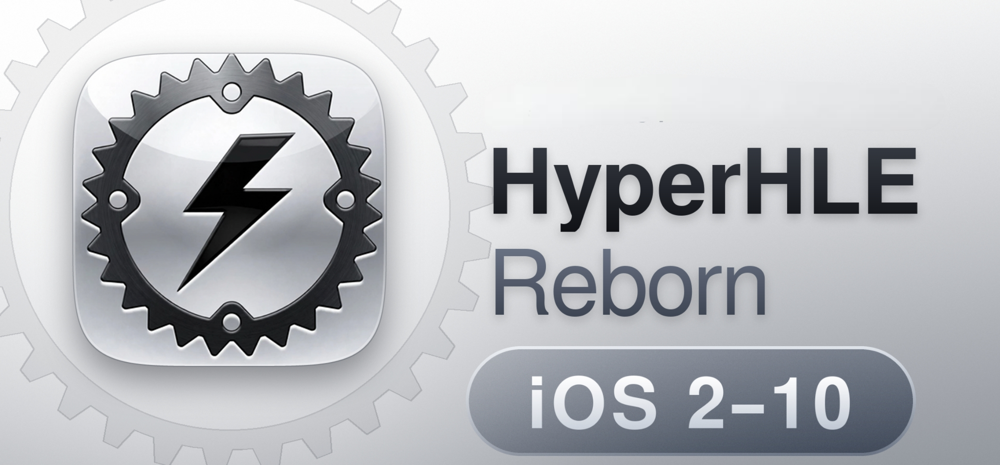

# VetusCore

<p align="center"></p>
**VetusCore** is the emulator core used by Alpine Launcher's Vetus app. It is a fork of [HyperHLE-Reborn](https://github.com/KlugKlugTG/HyperHLE-Reborn), which carries forward [HyperHLE](https://github.com/HyperHLE/HyperHLE) and [touchHLE](https://github.com/touchHLE/touchHLE). This fork adds an embedded Android host interface and compatibility fixes. The upstream project names, source notices, and contributor history are retained to acknowledge their work.

VetusCore is a high-level emulator for early iPhone OS apps. It reimplements selected iOS frameworks on the host, allowing compatible apps to run without booting iOS. This fork focuses on Android/mobile usability, fullscreen and orientation handling, graphics compatibility, and app-specific fixes. It is independently maintained and is not an official Apple, touchHLE, HyperHLE, or HyperHLE-Reborn product.

The repository does not distribute commercial apps or iOS firmware. Put an app bundle (`.app`) or IPA (`.ipa`) that you are entitled to use in `touchHLE_apps/`; it will appear in the app picker.

## Platforms and features

- Builds for Android, iOS, Windows, macOS, and Linux. The iOS app comes from [Applesauce](https://github.com/johnny901901901/Applesauce); see [`platform/ios`](platform/ios/README.md).
- Virtual iPhone and iPad device profiles.
- Android touch input and fullscreen/orientation handling.
- Ongoing GLES, EAGL, Core Animation, audio, and iOS framework compatibility work.
- Build the embedded Android core with the [Vetus embedded workflow](https://github.com/MarkusMaribu/VetusCore/actions/workflows/vetus_embedded.yml). The [upstream HyperHLE workflow](https://github.com/KlugKlugTG/HyperHLE-Reborn/actions/workflows/HyperHLE_release.yml) provides upstream builds.

## Upstream compatibility reports

The titles below have been tested with HyperHLE-Reborn and are known to run. Compatibility may still vary with the app version, virtual device profile, host GPU/driver, and settings; this list does not guarantee that every feature or a full playthrough works.

- N.O.V.A. 3 (Playable)
- Gangstar Vegas (Unplayable on adreno)
- Geometry Dash (Playable)
- Terraria (Playable)
- Modern Combat 3 (Playable)
- Asphalt 7 (Playable)
- Turbo Dismount (Playable)
- Scarface (Playable)
- Zombie Safari (Playable)
- Real Racing 1 (Playable)
- Real Racing 3 (Playable)
- Silent Ops (Playable)
- Need For Speed: Most Wanted (Playable)
- Minecraft 0.14.2-0.16.2 (Playable)
- Oceanhorn (Playable)
- Asphalt 8 (Playable)
- GTA 3 (Ingame)
- Granny (Ingame)
- Talking Tom Hero Dash (Playable)
- My Talking Hank (Playable)
- And more more games

## Build and documentation

Build and run a desktop version with Cargo:

```sh
cargo run --release -- path/to/app.app
```

For iOS build steps and the unsigned IPAs, see [`platform/ios`](platform/ios/README.md). For Android build steps, see the `android/` directory and the [CI workflow](https://github.com/KlugKlugTG/HyperHLE-Reborn/actions/workflows/HyperHLE_release.yml). Command-line options are documented in [`OPTIONS_HELP.txt`](OPTIONS_HELP.txt); notable compatibility changes are tracked in [`CHANGELOG.md`](CHANGELOG.md).

## Community

Join the [HyperHLE Discord server](https://discord.gg/ZpEkAV47H9) to discuss the project and contribute.

## Credits and license

VetusCore carries forward work from HyperHLE-Reborn, HyperHLE, touchHLE, and their contributors. Its emulator source and modifications remain under the [Mozilla Public License 2.0](LICENSE). Copyright remains with the respective contributors; the fork does not transfer ownership of upstream work.

See [NOTICE](NOTICE) for attribution and the source location, and [LICENSING.md](LICENSING.md) for third-party licenses and binary distribution requirements. Bundled libraries, fonts, platform code with separate notices, and development tools retain their respective licenses.
